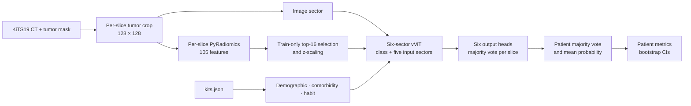

# Renal tumor grade classification with vViT

This project recreates a multimodal pipeline for binary WHO/ISUP grade prediction from KiTS19 CT tumor crops, radiomics, and clinical data. It is a learning and methods-reproduction project; the goal is to document the pipeline and evaluate it honestly, not to optimize accuracy or provide clinical predictions.

## Pipeline



Patients, not slices, define all train/validation/test splits. Top-16 radiomic selection, radiomic scaling, and continuous clinical scaling are fit on training patients only. Training balances classes by image subsampling; validation and test retain their observed prevalence.

## Current cohort and results

- Cohort: 171 patients (119 low grade, 52 high grade) from 210 KiTS19 cases; one image-count outlier excluded after clinical and grade eligibility.
- vViT: three paper-style split seeds and five patient-level CV folds completed. Pooled out-of-fold patient AUROC: **0.608 (95% CI 0.510–0.699)**; patient accuracy: **0.620**.
- Image baselines: pretrained ViT, ConvNeXt, and ResNeXt evaluated on the seed-42 31-patient test set.
- Permutation importance on seed 42 showed the largest accuracy drops for clinical sectors; radiomic and image drops were small. This differs from the paper's reported radiomics-dominant pattern and is treated as an exploratory result.

These estimates are uncertain because each held-out test set is small. See [the full results report](docs/final_report_2026-10-25.md), [vViT run tables](docs/vvit_results_2026-10-25.md), [permutation analysis](docs/vvit_permutation_importance_2026-10-25.md), and [baseline comparison](docs/vvit_baseline_comparison_2026-10-25.md).

## Reproducing analysis

Use the pinned environment in `requirements.txt` and provide the KiTS19 files and generated processed artifacts described in `tasks/plan.md`.

```powershell
# Train/evaluate the three image baselines (already completed)
python -u src/training/run_baselines.py --models vit convnext resnext --num-workers 2

# Evaluate existing baseline checkpoints without retraining
python -u src/training/run_baselines.py --eval-only

# Recompute vViT seed-42 permutation importance from its saved checkpoint
python -u src/training/permutation_importance.py --n-permutations 100 --seed 42 --output-tag seed42

# Compare vViT with the existing image-baseline predictions
python -u src/training/compare_vvit_baselines.py

# Run the saved model on a held-out test patient (optional: --patient-id case_XXXXX)
python -u src/training/demo.py
```

Generated checkpoints, predictions, and figures live under git-ignored `results/`. Detailed protocol decisions, deviations, limitations, and references to artifacts are in `tasks/plan.md`, `tasks/todo.md`, and `LOG.md`.
